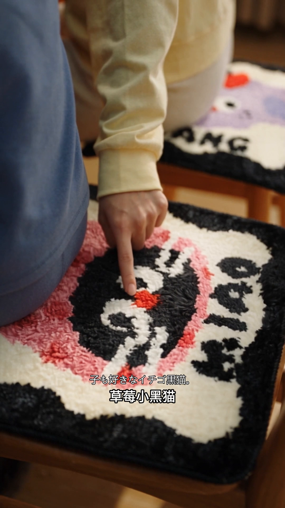

# 大硕跨境电商批量翻译配音

把已有中文电商视频制作成面向海外市场的字幕版或配音版。默认保留商品、动作、镜头顺序及卖点，按语种选择本地或在线配音，使用本地模型分离背景声，不调用 GhostCut API。

当前源码版本 **v1.9.1**（2026-10-24）。技术调用名：`$dashuo-crossborder-localizer`。

## 三条制作通道

| 通道 | 制作内容 | 原中文字幕 | 声音处理 | 当前状态 |
| --- | --- | --- | --- | --- |
| 1. 简化字幕版 | 翻译＋目标语言字幕 | 保留，译文紧邻正上方 | 保留全部原声 | 已实现、本地实测 |
| 2. 配音字幕版，默认 | 翻译＋目标语配音＋字幕＋响度校准 | 保留，形成双字幕 | 替换中文旁白，保留BGM和音效 | 已实现、本地实测 |
| 3. 去字幕配音版 | 线上去原字幕，再制作配音与目标语字幕 | 去除 | 替换旁白，保留BGM和音效 | 组合流程已定义，线上去字幕未完成整链实测 |

第3条是**线上 Seedance 2.5 编辑交接＋本地配音字幕**。仓库不提供已接通的线上执行器，也不附带线上账户、项目配置或费用额度；需要配置实际编辑通道，并在上传/付费前取得对应授权。旧 `erase` 命令仍是已知会模糊纹理、可能漏字的 MI-GAN 历史入口，不是 Seedance 调用命令。详见[线上去字幕交接](references/online-subtitle-erasure.md)。

## 实际样例截图

以下来自同一条簇绒坐垫案例的真实制作结果，展示已完成的通道1、2。目标语紧邻原中文字幕正上方；点击图片查看原尺寸。截图展示画面和字幕，配音、BGM与响度效果以实际试听为准。

| 简化字幕版 · 马来语 | 配音字幕版 · 马来语女声 v5 | 配音字幕版 · 日语女声 v9 |
| --- | --- | --- |
| [](docs/screenshots/subtitles-only-ms.png) | [](docs/screenshots/dub-malay-female-v5.png) | [](docs/screenshots/dub-japanese-v9.png) |

<details>
<summary>展开：六市场逐句字幕位置对照</summary>

覆盖新加坡英语/华语、马来西亚马来语/英语、日语和通用英语的六句字幕位置。华语目标保留原中文，避免重复叠字。该图用于查看字幕排版，不作为六种当地口音已通过的证明。

[](docs/screenshots/six-market-subtitle-layout.png)

</details>

<details>
<summary>展开：原片与字幕编码后的纹理对比</summary>

左侧是原片，右侧是v8字幕编码后的同帧原尺寸局部，保留了原图中的景深虚化。v9仅改音轨，沿用相同视频流。该图用于观察坐垫和人物细节；烧录字幕仍有编码损失，不能称完全无损。

[](docs/screenshots/source-vs-encoded-texture.png)

</details>

截图来源与版本见[样例索引](docs/screenshots/README.md)。

## 支持的市场、语言与默认音色

已配置所需的 **7个市场、9种语言市场组合**，另保留通用英语、普通话及台湾繁中配置，共12个目标配置。以下为维护者已部署流程中**原片为女声**的默认搭配；默认不会克隆原作者。机器配置见 [languages.json](references/languages.json)，选择方式见[多市场音色](references/market-voices.md)。

首次安装需按[运行环境](references/runtime.md)配置自己的解释器、模型目录和各目标覆盖项。仓库不分发维护者的 `local-runtime.json`；未配置环境时，基础CLI仍生成待配置的Chatterbox任务，新增市场再按语言表补充路由计划，不会自动完成上表全部本地引擎的部署或选型。

| 市场 | 目标配置 | 默认引擎与女声 | 当前实测状态 |
| --- | --- | --- | --- |
| 日本 | `ja-JP` 日语 | 本地 Qwen · `Ono_Anna` | 已有商品整片试听；日语v9响度获用户认可 |
| 韩国 | `ko-KR` 韩语 | 本地 Qwen · `Sohee` | 真实短句已合成；商品整片与母语自然度待验 |
| 泰国 | `th-TH` 泰语 | 百炼 Sambert · Waan（`sambert-waan-v1`） | 真实短句已合成并返回用量；商品整片与母语听审待验 |
| 菲律宾 | `fil-PH` Filipino / Tagalog | Edge 在线 · **`fil-PH-BlessicaNeural`** | 同句对比试听获用户偏好认可，已设默认；商品整片待验 |
| 马来西亚 | `ms-MY` 马来语 | 本地 Chatterbox · `serena-female-v1` 合成女声参考 | 马来语女声v5商品样片获用户认可 |
| 马来西亚 | `en-MY` 英语 | 本地 Qwen · `Serena` | 历史通用英语整片技术合成使用Aiden；当前默认女声整片与当地英语口音待验 |
| 新加坡 | `en-SG` 英语 | 本地 Qwen · `Serena` | 历史通用英语整片技术合成使用Aiden；当前默认女声整片与新加坡英语口音待验 |
| 新加坡 | `zh-SG` 华语 | 本地 Qwen · `Serena` | 普通话商品整片已技术合成；新加坡华语口音未验 |
| 印度尼西亚 | `id-ID` 印尼语 | 百炼 Sambert · Indah（`sambert-indah-v1`） | 真实短句已合成并返回用量；商品整片与母语听审待验 |

额外保留的配置：

| 目标配置 | 默认女声与用途 | 验证范围 |
| --- | --- | --- |
| `en-US` | Qwen `Serena`；未指定女声时通用预设为 `Ryan` | 通用英语；历史Aiden整片不代表当前女声验收 |
| `zh-CN` | Qwen `Serena`；普通话对照 | 沿用普通话路线，不另称新增地区实测 |
| `zh-TW` | Qwen `Serena`；繁体字幕与台湾常用词 | 繁中字幕逻辑已测；商品整片与台湾国语口音未验，不含闽南语 |

地区选择用于翻译语境，并不自动生成当地口音。Filipino不包含宿务语，印尼语与马来语分别处理；越南语 `vi-VN` 仍待协商，未接入当前默认流程。短句合成、技术成片、用户试听认可与母语审听分别记录，不从一个样句推断所有后续视频都已验收。

**菲律宾语默认规则：** 使用微软 Edge 在线 Blessica 女声；这是 `edge-tts` 通道，并非 Azure 计费API，不套用百炼额度或Azure服务承诺。百炼 `MiniMax/speech-2.8-turbo`＋`female-shaonv` 保留为显式可选路线，后者是跨语言系统音色，不标作菲律宾原生专属女声。失败时不自动切换。泰语Waan、印尼语Indah及其他本地路线保持原配置。

## 在 Codex 中安装和使用

把下面这句话发给能使用 Skill 安装器的 Codex：

```text
使用 skill-installer，从 https://github.com/yongbinlan/dashuo-crossborder-localizer
仓库根目录安装 dashuo-crossborder-localizer。
```

仓库已公开，可直接下载。也可将含 `SKILL.md` 的完整目录放入当前用户的 Codex skills 目录；遇到同名版本先备份。装好后检查可用技能列表，必要时刷新会话。

**安装 Skill 不等于部署模型。** 核心脚本需要 Python 3.10+、FFmpeg/ffprobe（含libass、libx264、AAC、loudnorm）。语音识别、配音与分离模型各自部署在独立环境，填写真实路径；仓库不带权重、本机配置或密钥，不会在处理视频时自动下载模型。详见[运行环境](references/runtime.md)。

菲律宾语需要在独立Python环境安装 `edge-tts`；泰语、印尼语需部署 `dashscope`、开通对应百炼服务，并通过环境变量 `DASHSCOPE_API_KEY` 提供密钥。密钥不写入Skill、任务文件或仓库。在线TTS仅发送台词，不自动上传原视频或真人声音样本；翻译请求的权限单独处理。可在运行环境配置各语种的Python路径。

在线TTS默认关闭。用户授权发送台词后，初始化可加 `--allow-online-tts`；百炼还须在明确费用授权后加 `--allow-paid-tts`。这两个开关不会自动批准远程翻译、线上去字幕或发布。详见[百炼配置与恢复](references/bailian-tts.md)。

默认配音可以这样说：

```text
使用 $dashuo-crossborder-localizer，将这个文件夹中的中文电商视频
制作成日语、新加坡英语和马来西亚马来语版本。
保留商品、镜头和中文字幕，保留BGM与音效，原女声配女声，
按默认响度流程制作，目标字幕位于原中文字幕正上方。
优先本地运行，不自动上传、付费或投放。
```

仅字幕可以这样说：

```text
使用 $dashuo-crossborder-localizer，仅翻译并添加日语和马来语字幕，
保留全部原声和中文字幕，不配音、不分离人声。
```

每个视频×语种单独输出版本目录，包含MP4、目标语/双语SRT、ASS、预览和回执。配音通道另保留原始及校准旁白、混音、背景声、时轴与响度证据；失败单独报告，旧版不覆盖。

## 默认响度与画质保护

- 旁白先做两遍响度校准，单声道目标 **-20 LUFS / -3 dBTP**，再驱动背景混音及音乐避让。
- 混音再做交付校准，目标 **-16 LUFS / -1.5 dBTP**；重新测量最终AAC，而不只看中间WAV。参数来自已认可试听，不宣称是所有投放平台的统一标准。
- 仅改声音且字幕内容、时间轴与布局不变时，复用已核验的视频流；无需新增字幕时直接复制原视频流。
- 需要烧录或修改字幕时，从绑定原片编码一次，避免旧成片反复压缩。烧录字幕仍是有损编码，不能称完全无损。
- 默认后期最多 **1.10倍**，超时先处理译文长度或配音，不截词、不突然拉快末句，也不拉长画面塞台词。

参数范围、实际容差与产物说明见[响度与画质](references/loudness-and-picture.md)、[任务契约](references/job-contract.md)和[保声配音](references/preserved-audio.md)。

## 费用与验证边界

本地模型与FFmpeg不调用付费API；翻译使用当前Codex时仍受宿主额度/费用影响，不能称整套流程永久免费或全离线。可选在线TTS、远程翻译及线上去字幕需要对应的数据和费用授权。分离模型不能保证音乐、音效或人声完全无损，仍须逐片听检。

v1.9.1的公开仓库布局已复跑 **88项回归测试通过**，包括语言路由、女声匹配、在线/付费权限隔离、百炼缓存防重复收费、字幕布局、时轴、响度和视频流复用等。测试使用本地合成夹具及模拟API，不新增付费TTS，也不重新生成业务视频。上表的真实短句、整片和试听状态来自此前逐项实测，不由回归测试替代。

维护者可在仓库根目录复跑：

```powershell
python -X utf8 -m unittest discover -s tests -p "test_*.py" -v
python -X utf8 scripts/localize.py languages
python -X utf8 scripts/localize.py doctor
```

FFmpeg/ffprobe必须可用；少数图像渲染检查使用Windows中文字体。`doctor`用于环境盘点，不证明模型已加载、外语发音正确或整片已验收。

第三方代码与模型各有许可，模型权重不随仓库分发；包括BandIt权重在内的许可不能用其他项目许可证替代。来源、已有研究及未实现能力见[来源与能力边界](references/sources-and-capabilities.md)。本仓库不是GhostCut官方产品，也不包含其闭源模型或服务端代码。
